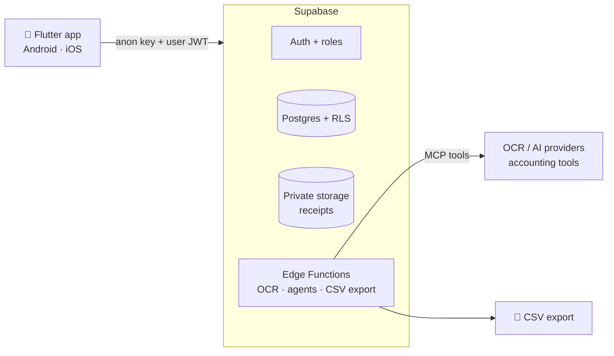

<p align="center">
  <a href="https://github.com/exceev-technology/rembo">
    <picture>
      <source media="(prefers-color-scheme: dark)" srcset=".github/assets/logo-dark.svg">
      
    </picture>
  </a>
</p>

<h3 align="center">The open-source alternative to Jenji for expense management</h3>

<p align="center">
  Expense reports for small and medium-sized businesses in Morocco.<br>
  <b>AI agents prepare every expense. A person decides.</b>
</p>

<p align="center">
  <a href="https://github.com/exceev-technology/rembo/wiki"><b>Wiki</b></a> ·
  <a href="https://github.com/exceev-technology/rembo/wiki/Roadmap"><b>Roadmap</b></a> ·
  <a href="https://github.com/orgs/exceev-technology/projects/1"><b>Project board</b></a> ·
  <a href="https://github.com/exceev-technology/rembo/discussions"><b>Discussions</b></a> ·
  <a href="CONTRIBUTING.md"><b>Contributing</b></a>
</p>

<p align="center">
  <a href="https://github.com/exceev-technology/rembo/actions/workflows/ci.yml"></a>
  <a href="https://scorecard.dev/viewer/?uri=github.com/exceev-technology/rembo"></a>
  <a href="LICENSE"></a>
  <a href="https://docs.flutter.dev"></a>
  <a href="https://supabase.com"></a>
  <a href="CONTRIBUTING.md"></a>
</p>

---

> [!NOTE]
> **Rembo is in early development.** The MVP is built in one-week Scrum sprints and will be presented on **8 December 2026**. Follow along on the [project board](https://github.com/orgs/exceev-technology/projects/1), and [star the repo](https://github.com/exceev-technology/rembo) to keep up with releases.

## Why Rembo?

In many Moroccan SMEs, one person handles payroll, HR and expense reports. Receipts fade or get crumpled, invoices arrive without an **ICE**, VAT (**TVA**) is hard to recover, and every line is typed again into a spreadsheet.

Rembo turns that into four steps: **capture, understand, approve, export**.

- 📸 **Capture.** Employees photograph a receipt; OCR suggests the date, supplier, amount and VAT, and they check and correct it.
- 🤖 **Understand.** AI agents classify the expense, check it against the company policy and flag duplicates. Every agent action is logged.
- ✅ **Approve.** Managers handle exceptions: they approve or reject with a reason. Nobody approves their own expense.
- 📤 **Export.** Accountants review approved expenses and export a documented **CSV** that any accounting software or ERP can import.

It is built for Morocco (amounts in **MAD**, Moroccan VAT rates and ICE) and it is **open source**: a company can audit the code and host it itself, with no per-employee license.

## Features

| Feature | Description | Status |
| --- | --- | --- |
| Accounts and roles | Employee, manager and accountant roles per company, enforced by Row Level Security | 🚧 Sprint 1 |
| Expense entry | Category, reason, client or project allocation, receipt upload to private storage | 🗓️ Sprint 2 |
| Receipt capture and OCR | Field extraction with a review and correction screen | 🗓️ Sprint 3 |
| Approval workflow | Submit, approve or reject with a reason, expense policy, status history | 🗓️ Sprint 4 |
| Mobile MVP | The full journey on **Android and iOS** | 🗓️ Sprint 5 |
| CSV accounting export | Approved expenses exported as a documented CSV | 🗓️ Sprint 6 |
| WhatsApp and voice notes in darija | Declare an expense without typing | 💡 After the MVP |

Out of scope for the MVP: web app and PWA, desktop apps, direct ERP connectors (Sage, etc.), bank transfers, payment cards, payroll, legally binding archiving and full offline sync. See the [Roadmap](https://github.com/exceev-technology/rembo/wiki/Roadmap).

## Tech stack

| Layer | Technology |
| --- | --- |
| Mobile app | [Flutter](https://flutter.dev) 3.47 / Dart 3.13 for Android and iOS |
| Backend | [Supabase](https://supabase.com): Postgres, Auth, Row Level Security, Storage, Edge Functions |
| AI agents | OCR and agents called from Edge Functions; tools reached through the [Model Context Protocol (MCP)](https://modelcontextprotocol.io) |
| CI/CD | GitHub Actions: format, analyze, test, Android and iOS builds, security scans |



Secrets such as the `service_role` key and the OCR or AI keys stay in Edge Functions. The app only ships the public `anon` key. More in [Architecture](https://github.com/exceev-technology/rembo/wiki/Architecture).

## Getting started

**Prerequisites:** [Flutter 3.47 (stable)](https://docs.flutter.dev/get-started/install), Android Studio and/or Xcode, and the [Supabase CLI](https://supabase.com/docs/guides/local-development/cli/getting-started) with Docker.

```bash
git clone https://github.com/exceev-technology/rembo.git
cd rembo
flutter pub get

# Local backend (Supabase stack in Docker)
supabase start

# Configure the app with the URL and anon key printed by `supabase start`
cp .env.example .env
flutter run --dart-define-from-file=.env
```

Run the same checks as CI before you push:

```bash
dart format .
flutter analyze
flutter test
```

The full guide covers emulators, the local Supabase stack and troubleshooting: [Development Setup](https://github.com/exceev-technology/rembo/wiki/Development-Setup).

## Project structure

```text
rembo/
├── lib/                  # Flutter app, organized by feature (lib/features/<feature>/)
├── test/                 # Unit and widget tests
├── android/ ios/         # Mobile platform projects
├── supabase/             # Migrations, RLS policies, Edge Functions (from Sprint 1)
├── docs/wiki/            # Wiki source, published to the GitHub wiki on merge
└── .github/              # CI workflows, templates, Dependabot, CODEOWNERS
```

## Contributing

Contributions are welcome, from first-timers too! 💜 We work in **Scrum with one-week sprints** on a [GitHub project board](https://github.com/orgs/exceev-technology/projects/1). Every change goes through a reviewed pull request into a protected `main` branch.

1. Read [CONTRIBUTING.md](CONTRIBUTING.md) and the [Git & PR Workflow](https://github.com/exceev-technology/rembo/wiki/Git-and-PR-Workflow)
2. Pick a [`good first issue`](https://github.com/exceev-technology/rembo/issues?q=is%3Aopen+label%3A%22good+first+issue%22), or open a [feature request](https://github.com/exceev-technology/rembo/issues/new?template=feature_request.yml) or [bug report](https://github.com/exceev-technology/rembo/issues/new?template=bug_report.yml)
3. Open a pull request with a [Conventional Commits](https://www.conventionalcommits.org/) title

New to the stack? Start with the [Learning Path](https://github.com/exceev-technology/rembo/wiki/Learning-Path): Scrum on GitHub, Git and pull requests, Flutter, Supabase and MCP.

## Community and support

- 💬 Questions and ideas: [GitHub Discussions](https://github.com/exceev-technology/rembo/discussions)
- 🐛 Bugs and features: [GitHub Issues](https://github.com/exceev-technology/rembo/issues)
- 📚 Docs: [the wiki](https://github.com/exceev-technology/rembo/wiki)
- 🤝 Everyone follows our [Code of Conduct](CODE_OF_CONDUCT.md). More in [SUPPORT.md](SUPPORT.md).

## Security

Found a vulnerability? Please **don't open a public issue**. Report it privately as described in [SECURITY.md](SECURITY.md).

## Contributors

<a href="https://github.com/exceev-technology/rembo/graphs/contributors">
  
</a>

## Acknowledgements

Rembo started in the **ECC Innovation Project 2026** (Project 02), a collaboration between students of [École Centrale Casablanca](https://centrale-casablanca.ma) and [Exceev Technology](https://exceev.com).

## License

Rembo is released under the [MIT License](LICENSE):

- **Free to use and self-host.** A company can run Rembo on its own servers, with no per-employee license.
- **Auditable.** Anyone can read the code that handles their financial data.
- **Free to adapt.** Change it, extend it, or integrate it with your accounting tools.
