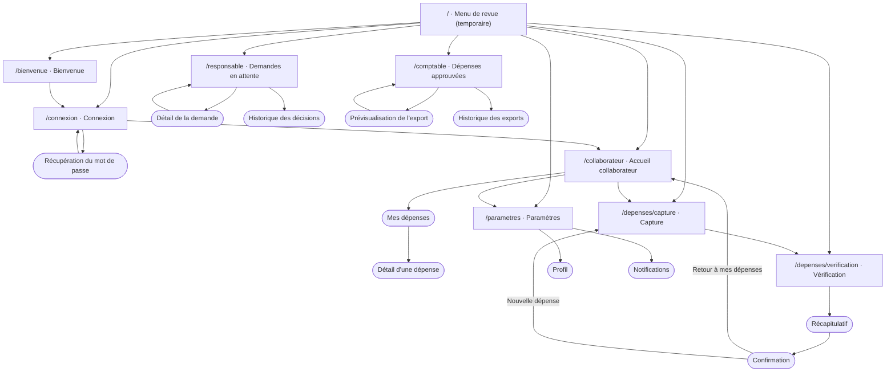

# Carte de navigation REMBO — V1

Issue #17. Les **routes nommées** (constantes `AppRoutes`) sont les seules portes d’entrée publiques ; les écrans internes d’un module sont poussés par le module lui-même avec `MaterialPageRoute`, sans toucher au routeur commun.

Rectangles : routes nommées. Formes arrondies : écrans internes.

## Règles de navigation
- **Aller à une route** : `Navigator.of(context).pushNamed(AppRoutes.capture)` ; jamais de chaîne littérale.
- **Passer des données** entre capture et vérification : `pushNamed(AppRoutes.review, arguments: draft)` ; l’écran lit `ModalRoute.of(context)?.settings.arguments` et démarre avec un brouillon vide s’il n’en reçoit pas (accès direct).
- **Retour** : la flèche de l’AppBar et le retour système dépilent un écran ; aucune donnée saisie n’est perdue en revenant d’un cran.
- **Fin de parcours** (confirmation, connexion réussie) : remplacer la pile pour que « retour » ne ramène pas dans un formulaire terminé — `pushNamedAndRemoveUntil(AppRoutes.collaborator, (r) => r.isFirst)`.
- **Destination non livrée** : le routeur affiche `PlaceholderScreen` ; un bouton peut donc pointer dès maintenant vers une route dont l’écran n’existe pas encore.
- **Route inconnue** : page « Cet espace est introuvable » avec retour au menu.
