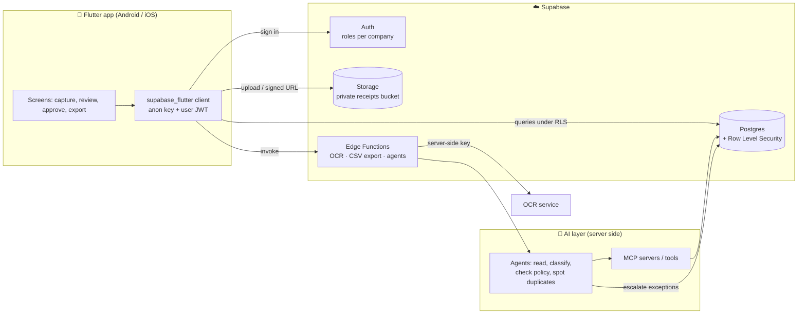
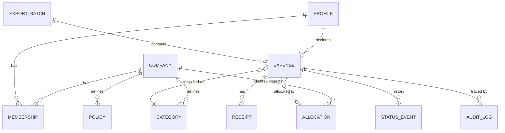

# Architecture

Rembo is a **Flutter mobile app (Android + iOS)** backed by **Supabase**. AI agents run on the server and reach tools through **MCP**. No secret ever reaches the phone.

## Overview

## Supabase building blocks

| Building block | Use in Rembo |
|---|---|
| **Postgres** | Expenses, categories, expense policies, clients/projects for allocation, export batches, audit log |
| **Auth** | Employee, manager and accountant accounts, with a role **per company** |
| **Row Level Security** | Everyone sees only their own expenses; a manager sees their team's; no self-approval |
| **Storage** | Receipts in a **private bucket**, accessed through short-lived **signed URLs** |
| **Edge Functions** | OCR calls, CSV export generation, agent calls. API keys stay on the server |

The client/project reference data is managed directly in Supabase for the MVP.

## AI agents, MCP and human-in-the-loop

> **Agents prepare, a human decides.**

| Agent | Where it runs | What it does | What it cannot do |
|---|---|---|---|
| **Read** | Phone first (Google ML Kit, offline), server reader only when the phone finds nothing | Extracts date, supplier, amount, currency, VAT, VAT rate and ICE. Each field carries **how it was found** and a **confidence** (sure, probable, to check); what it could not read is listed | Submit the expense |
| **Classify** | Phone, no model | Proposes the category and the client/project: first from the person's own history with the same supplier (or ICE), then from Moroccan supplier names (petit taxi, ONCF, Afriquia, riad…). Says why | Overwrite a choice the person made |
| **Check policy** | Server (SQL `control_expense`), previewed on the phone | Limits, missing receipt, missing fields, duplicates, ambiguities. Writes its reasons on the expense | Approve or reject, unless the company switched automatic validation on |
| **Prepare export** | Phone and server | Builds the batch of approved expenses and checks its totals | Run the accounting import |

**Escalation rule.** By default the control only **marks** a compliant expense; a manager confirms all the compliant ones in one gesture, and decides alone on the others. A company may let the control approve compliant expenses itself (« Validation automatique des dépenses conformes »). A manager decides in every case where the control found:

1. **An inconsistency** between the expense and the reimbursement policy
2. **An ambiguity** the agent cannot resolve on its own

**Guardrails**

- An employee can never approve their own expense, whether a human or an agent does the approving.
- Every agent action is written down: status changes carry who or what acted (`actor_kind` human or agent), when and why.
- The agents are explainable code, not models: they run without cost or key, on the phone or in SQL. Only the optional server reader calls a vision model, whose key stays in Edge Function secrets.
- **MCP** and a conversational assistant are part of the [post-MVP vision](Product-Vision#vision-after-the-mvp).

## Security model

| Rule | Enforced by |
|---|---|
| A user only reads their own expenses and receipts | RLS on `expenses` and Storage policies on the receipts bucket |
| A manager reads and decides on their team's expenses only | RLS based on company membership and role |
| Nobody approves their own expense | RLS / check constraint on the decision (`decided_by <> employee_id`) |
| The accountant reads approved expenses of their company and creates exports | RLS by role and company |
| The `service_role` key and OCR / AI keys never leave the server | Edge Functions secrets; only the public `anon` key is in the app |

Every feature ships with its RLS policies **and tests for them** (see the Definition of Done in [Scrum on GitHub](Scrum-on-GitHub#definition-of-done)).

## Data model

> ⚠️ **Draft – to be validated in Sprint 1.** Names and columns will change. The migrations in the repository are the source of truth.

| Table | Key columns (draft) |
|---|---|
| `companies` | `id`, `name`, `ice`, `currency` (default `MAD`) |
| `profiles` | `id` (= auth user), `full_name` |
| `memberships` | `company_id`, `profile_id`, `role` (`employee` \| `manager` \| `accountant`), `manager_id` |
| `categories` | `company_id`, `name`, `default_vat_rate` |
| `policies` | `company_id`, `category_id`, `alert_limit_mad`, `required_fields` |
| `allocations` | `company_id`, `kind` (`client` \| `project`), `name` |
| `expenses` | `id`, `company_id`, `employee_id`, `expense_date`, `supplier_name`, `supplier_ice`, `amount_ttc_mad`, `vat_rate`, `vat_amount_mad`, `category_id`, `allocation_id`, `reason`, `status` |
| `receipts` | `expense_id`, `storage_path`, `ocr_payload`, `field_sources` |
| `status_events` | `expense_id`, `from_status`, `to_status`, `actor_id`, `actor_kind` (`human` \| `agent`), `reason`, `created_at` |
| `export_batches` | `id`, `company_id`, `created_by`, `created_at`, `expense_count`, `total_mad` |
| `audit_log` | `actor_id`, `actor_kind`, `action`, `expense_id`, `details`, `created_at` |

Expense status flow (draft): `draft` → `submitted` → `needs_review` (escalated) → `approved` \| `rejected` → `exported`.

## CSV export

> ⚠️ **Draft – to be validated in Sprint 6** with the accountants we interview.

- One row per approved expense, UTF-8, header row, `;` separator, decimal point `.`, dates `YYYY-MM-DD`
- The approved total must equal the exported total (checked in the [Testing Protocol](Testing-Protocol)). The export agent adds the batch up before the export, the server records its count, total and VAT, and the app compares them after the export
- The format is documented in the repository so any accounting software or ERP can map it

| Column | Example | Notes |
|---|---|---|
| `expense_id` | `e7c1…` | Stable identifier |
| `expense_date` | `2026-11-12` | Date on the receipt |
| `employee` | `Youssef A.` | Declaring employee |
| `supplier_name` | `Café Atlas` | |
| `supplier_ice` | `001234567000089` | When printed on the receipt |
| `category` | `Meals` | |
| `account` | `6143` | Accounting account of the category, set by the company's accountant (« Comptes comptables »); empty when not set |
| `allocation` | `Client Atlas` | Client or project |
| `amount_ttc_mad` | `380.00` | Amount including VAT, in MAD: what is reimbursed |
| `vat_rate` | `10` | Percent printed on the receipt (20, 14, 10, 7 or 0); empty when unknown |
| `vat_amount_mad` | `34.55` | |
| `amount_ht_mad` | `345.45` | Amount excluding VAT |
| `currency` | `MAD` | Currency of the receipt (`MAD`, `EUR`, `USD`, `GBP`) |
| `amount_paid` | `35.00` | Amount paid in that currency, when it is not MAD; empty otherwise |
| `reason` | `Client lunch` | |
| `approved_by` | `Manager name` | |
| `approved_at` | `2026-11-13` | |
| `export_batch_id` | `b42…` | Groups one export |

## Repository layout

| Path | Content |
|---|---|
| `lib/` | Flutter app source |
| `test/` | Unit and widget tests |
| `android/`, `ios/` | Mobile platform projects (other platform folders are not part of the MVP) |
| `supabase/` | Migrations, seed data, Edge Functions (added in Sprint 1) |
| `docs/wiki/` | Source of this wiki |
| `.github/` | Issue/PR templates, CI and automation workflows |
